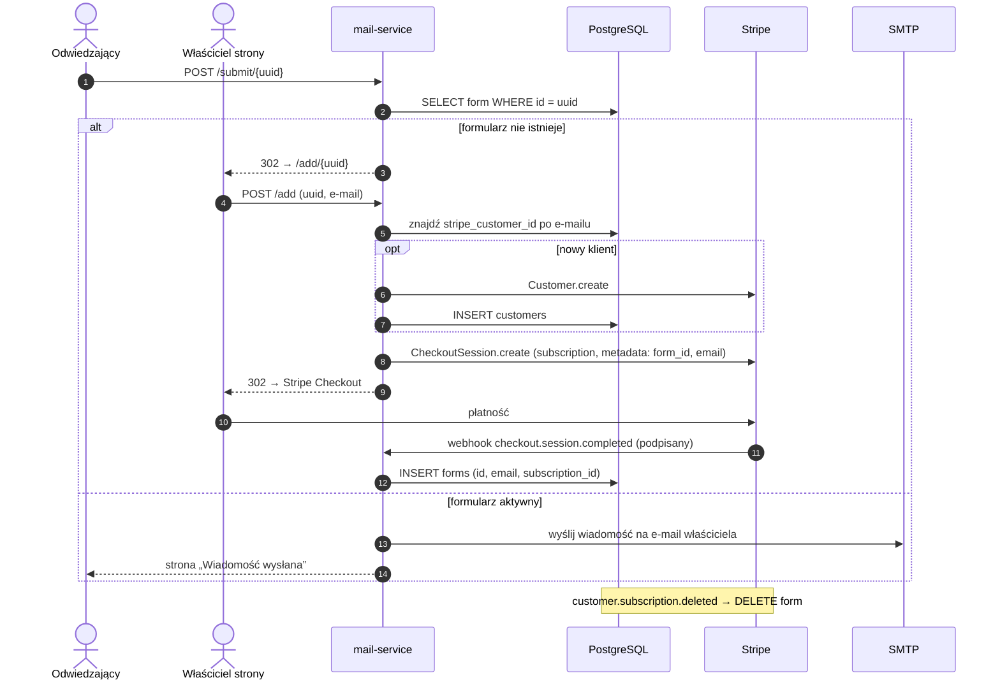
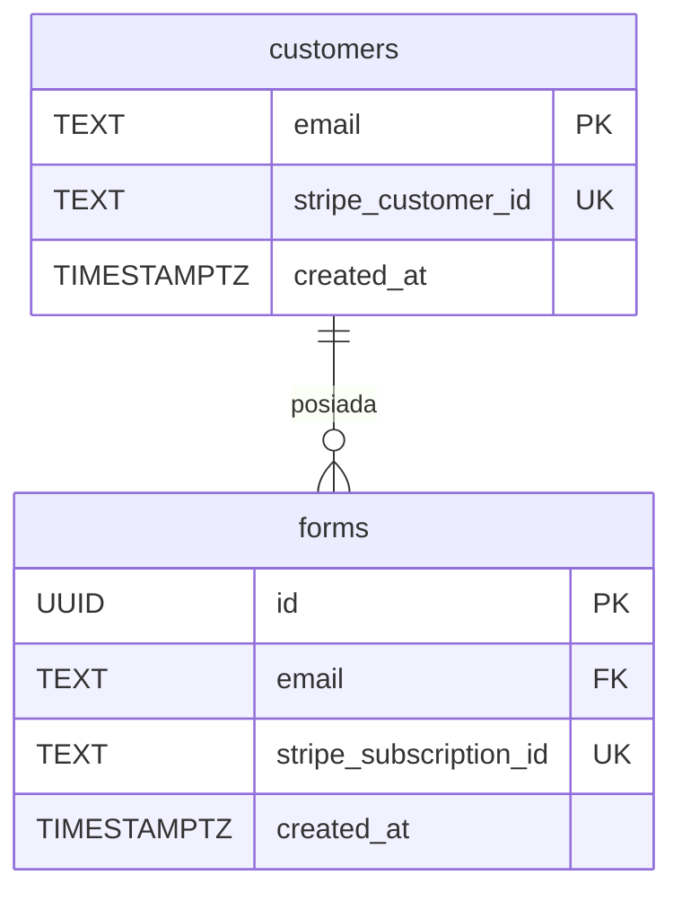

<div align="center">

# 📬 mail-service

**Formularz kontaktowy dla stron statycznych: bez backendu, bez bazy danych, bez JavaScriptu.**
Wklejasz jeden `<form>` i wiadomości od klientów trafiają prosto na Twój e-mail.

[](https://go.dev/)
[](https://gofiber.io/)
[](https://www.postgresql.org/)
[](https://stripe.com/)
[](https://www.docker.com/)
[](LICENSE)

🌐 **Działa produkcyjnie:** [mail.selfhosting.pl](https://mail.selfhosting.pl)

</div>

---

## 🤔 Jaki problem rozwiązuje?

Masz stronę na GitHub Pages, Netlify, Cloudflare Pages albo zwykłym hostingu z plikami HTML. Chcesz dodać formularz kontaktowy, ale strona statyczna nie wyśle maila, bo nie ma serwera.

Zwykle zostaje postawienie backendu, skonfigurowanie SMTP i pilnowanie, żeby to wszystko działało. **mail-service** zastępuje te kroki jednym fragmentem HTML:

```html
<form action="https://mail.selfhosting.pl/submit/<TWOJ-UUID>" method="POST">
  <input type="email" name="email" required>
  <textarea name="message" required></textarea>
  <button type="submit">Wyślij</button>
</form>
```

I tyle. Bez SDK, bez kluczy API po stronie klienta i bez frameworka.

## ✨ Funkcje

- **Zero konfiguracji po stronie użytkownika.** UUID generuje się w przeglądarce (`crypto.randomUUID()`), a formularz jest gotowy do skopiowania z wbudowanymi stylami.
- **Aktywacja przy pierwszym użyciu.** Pierwsze wysłanie nieznanego formularza przekierowuje właściciela do aktywacji: podaje e-mail docelowy i opłaca subskrypcję.
- **Subskrypcje Stripe.** Checkout, Customer Portal i webhooki. Anulowanie subskrypcji automatycznie wyłącza formularz.
- **Jeden klient, wiele formularzy.** Każdy formularz to osobna subskrypcja, ale przypisana do jednego `Stripe Customer` dla danego e-maila.
- **Prywatność.** Treść wiadomości nie jest zapisywana w bazie, tylko przekazywana mailem.
- **SEO i analityka.** Sitemap, `robots.txt`, dane strukturalne JSON-LD (schema.org) i śledzenie konwersji Google Ads.
- **Gotowe do wdrożenia.** Obraz Dockera, `docker compose`, hot-reload w trybie deweloperskim.

## 🏗️ Architektura

Projekt ma klasyczny, warstwowy układ **handler → service → repository**, a zależności są wstrzykiwane ręcznie w `main.go`, bez magii i bez kontenera DI.

```
mail-service/
├── cmd/app/main.go            # punkt wejścia: konfiguracja, DI, routing
├── config/                    # ładowanie i walidacja zmiennych środowiskowych
├── internal/
│   ├── form/
│   │   ├── handler.go         # warstwa HTTP (Fiber) + obsługa webhooków Stripe
│   │   ├── service.go         # logika biznesowa
│   │   ├── repository.go      # dostęp do PostgreSQL (database/sql + lib/pq)
│   │   ├── models.go          # struktury domenowe
│   │   ├── validate.go        # walidacja wejścia
│   │   └── validate_test.go   # testy jednostkowe (table-driven)
│   ├── mail/                  # wysyłka e-maili przez SMTP (go-mail, wymuszony TLS)
│   ├── payments/              # integracja ze Stripe (Customers, Checkout Sessions)
│   └── initializers/          # połączenie z bazą danych
├── migrations/                # wersjonowane migracje SQL
├── views/                     # szablony HTML (Fiber html/template + Tailwind + DaisyUI)
└── public/                    # pliki statyczne (robots.txt, sitemap.xml)
```

### Przepływ: od pierwszej wiadomości do aktywnego formularza



### Ciekawsze decyzje projektowe

| Decyzja | Dlaczego |
|---|---|
| **Formularz trafia do bazy dopiero po webhooku `checkout.session.completed`** | Zamyka lukę, w której ktoś mógłby zarejestrować formularz i nie zapłacić. Źródłem prawdy o stanie płatności jest Stripe, a nie redirect na `/success`. |
| **Weryfikacja podpisu webhooka + limit rozmiaru payloadu (64 KB)** | Chroni endpoint `/webhook` przed fałszywymi zdarzeniami i dużymi requestami. |
| **Osobna tabela `customers` z kluczem obcym `ON DELETE CASCADE`** | Jeden e-mail to jeden `Stripe Customer`, więc nie powstają duplikaty klientów przy kolejnych formularzach. |
| **`ON CONFLICT DO NOTHING` + mapowanie błędu PG `23505` na błąd domenowy** | Idempotentna obsługa wyścigów i ponownych webhooków bez wycieku szczegółów bazy do warstwy HTTP. |
| **UUID jako identyfikator formularza, generowany po stronie klienta** | Nie da się go zgadnąć, a użytkownik nie potrzebuje konta ani logowania. |
| **Błędy domenowe (`ErrNotFound`, `ErrFormAlreadyExists`, …)** | Handler decyduje o kodzie HTTP lub przekierowaniu na podstawie typu błędu, a nie tekstu. |
| **Treść wiadomości nie jest persystowana** | Mniej danych osobowych do chronienia, co upraszcza RODO. |

## 🛠️ Stack technologiczny

| Warstwa | Technologia |
|---|---|
| Język | **Go 1.25** |
| HTTP | [Fiber v2](https://gofiber.io/) (fasthttp) + middleware `recover` |
| Szablony | `gofiber/template/html` z layoutami i partialami |
| Baza danych | **PostgreSQL**, `database/sql` + `lib/pq`, czyste SQL bez ORM |
| Płatności | [stripe-go v84](https://github.com/stripe/stripe-go): Customers, Checkout, Webhooks, Customer Portal |
| E-mail | [wneessen/go-mail](https://github.com/wneessen/go-mail), SMTP z wymuszonym TLS |
| Konfiguracja | `caarlos0/env` (typowane, wymagane zmienne) + `godotenv` |
| Frontend | Tailwind CSS + DaisyUI, vanilla JS |
| DevOps | Docker, Docker Compose, CompileDaemon (hot-reload), Makefile |

## 🚀 Szybki start

### Wymagania

- Go **1.25+** albo Docker
- PostgreSQL
- Konto Stripe (wystarczą klucze testowe) i [Stripe CLI](https://docs.stripe.com/stripe-cli) do lokalnych webhooków
- Konto SMTP (domyślnie Gmail z [hasłem aplikacji](https://support.google.com/accounts/answer/185833))

### 1. Konfiguracja

```bash
git clone https://github.com/machayka/mail-service.git
cd mail-service
cp .env.example .env
```

| Zmienna | Opis |
|---|---|
| `PORT` | Port serwera (domyślnie `420`) |
| `DB_HOST`, `DB_PORT`, `DB_USER`, `DB_PASSWORD`, `DB_NAME` | Połączenie z PostgreSQL |
| `SMTP_USER`, `SMTP_PASS` | Dane logowania SMTP (nadawca wiadomości) |
| `STRIPE_KEY` | Sekretny klucz Stripe (`sk_test_…` / `sk_live_…`) |
| `PRICE_ID` | ID ceny subskrypcji w Stripe (`price_…`) |
| `DOMAIN` | Publiczny adres aplikacji, używany w `success_url` |
| `WEBHOOK_SECRET` | Sekret podpisu webhooków (`whsec_…`) |
| `PORTAL_LINK` | Link do Stripe Customer Portal |

Wszystkie zmienne poza `PORT` są **wymagane**. Aplikacja nie wystartuje z niekompletną konfiguracją (fail fast).

### 2. Migracje bazy danych

```bash
make migrate m=001_create_forms_table.sql
make migrate m=002_add_email_index.sql
make migrate m=003_add_customers_table.sql
```

### 3. Uruchomienie

```bash
# lokalnie
make run

# development w Dockerze z hot-reloadem
make dev

# produkcyjnie
docker compose up --build -d
```

Aplikacja wystartuje pod adresem `http://localhost:420`.

### 4. Webhooki Stripe lokalnie

```bash
stripe listen --forward-to localhost:420/webhook
```

Wypisany `whsec_…` wklej do `WEBHOOK_SECRET`.

### 5. Testy

```bash
go test ./...
```

## 🔌 Endpointy

| Metoda | Ścieżka | Opis |
|---|---|---|
| `GET` | `/` | Landing page z generatorem formularza |
| `POST` | `/submit/:id` | Odbiór wiadomości z formularza (`email`, `message`) |
| `GET` | `/add/:id` | Strona aktywacji nowego formularza |
| `POST` | `/add` | Utworzenie sesji Stripe Checkout |
| `GET` | `/success` | Strona po udanej płatności |
| `GET` | `/customer-portal` | Przekierowanie do Stripe Customer Portal |
| `POST` | `/webhook` | Webhooki Stripe (`checkout.session.completed`, `customer.subscription.deleted`) |
| `GET` | `/regulamin`, `/polityka-prywatnosci` | Dokumenty prawne |

## 🗄️ Schemat bazy



## 🗺️ Roadmap

Projekt działa produkcyjnie, ale jest jeszcze sporo do zrobienia. Chętnie przyjmę PR-y:

- [ ] Ochrona przed spamem (honeypot, rate limiting per IP / per formularz)
- [ ] Konfigurowalny host SMTP (obecnie `smtp.gmail.com` na sztywno)
- [ ] Narzędzie do migracji (np. `golang-migrate`) zamiast ręcznego `psql`
- [ ] Wieloetapowy `Dockerfile` (mniejszy obraz produkcyjny na `distroless`/`alpine`)
- [ ] Testy integracyjne dla repozytorium (testcontainers) i handlera webhooków
- [ ] Interfejsy dla `mail` i `payments`, żeby łatwiej mockować w testach serwisu
- [ ] Obsługa dodatkowych pól formularza (np. imię, temat) i przekierowania `_next`
- [ ] CI na GitHub Actions (`go vet`, `golangci-lint`, `go test`)

## 🤝 Contributing

1. Zrób fork repozytorium
2. Utwórz branch: `git checkout -b feature/super-funkcja`
3. Dodaj zmiany i testy, potem sprawdź, czy `go test ./...` przechodzi
4. Otwórz Pull Request z krótkim opisem: co i dlaczego

Bugi i pomysły zgłaszaj w [Issues](https://github.com/machayka/mail-service/issues).

## 📄 Licencja

[MIT](LICENSE) © 2025 Kacper Machaj

---

## 👋 O autorze (dla rekruterów)

Ten projekt zrobiłem samodzielnie, od pomysłu do działającego produktu z płatnościami: **[mail.selfhosting.pl](https://mail.selfhosting.pl)**. Pierwszy commit był 22.11.2025, a wersja produkcyjna z subskrypcjami ruszyła niecałe 3 tygodnie później.

**Co pokazuje ten projekt:**

- 🧱 **Backend w Go:** czysta architektura warstwowa, ręczne DI, idiomatyczna obsługa błędów (sentinel errors, `errors.As`) i table-driven testy.
- 💳 **Integracja płatności end-to-end:** Stripe Checkout w trybie subskrypcji, Customer Portal i webhooki z weryfikacją podpisu. Stan formularza zależy od zdarzeń Stripe, a nie od redirectów klienta.
- 🗃️ **Modelowanie danych:** PostgreSQL, wersjonowane migracje, klucze obce z kaskadą, ograniczenia unikalności wykorzystywane do idempotencji.
- 🔐 **Bezpieczeństwo i prywatność:** walidacja wejścia, weryfikacja webhooków, limit payloadu, wymuszony TLS w SMTP, brak przechowywania treści wiadomości, dokumenty prawne (regulamin, polityka prywatności).
- 🐳 **DevOps:** Docker, Docker Compose, hot-reload w dev, konfiguracja 12-factor przez zmienne środowiskowe z walidacją przy starcie.
- 📈 **Myślenie produktowe:** landing page, SEO (sitemap, JSON-LD), śledzenie konwersji Google Ads i dopracowany UX ścieżki „skopiuj → wklej → aktywuj”.

📫 Kontakt: [kacpermachay@gmail.com](mailto:kacpermachay@gmail.com) · GitHub: [@machayka](https://github.com/machayka)

<details>
<summary>🇬🇧 <b>TL;DR in English</b></summary>

**mail-service** is a production SaaS ([mail.selfhosting.pl](https://mail.selfhosting.pl)) that gives static websites a working contact form. You paste one HTML `<form>`, and submissions are delivered to your inbox. There is no backend, database or JavaScript on the user's side.

**Built solo with:** Go 1.25 · Fiber · PostgreSQL · Stripe (subscriptions, Checkout, Customer Portal, signed webhooks) · SMTP (go-mail) · Docker · Tailwind/DaisyUI.

**Highlights:** layered architecture (handler → service → repository) with manual dependency injection; payment state driven by verified Stripe webhooks rather than client redirects; idempotent persistence using DB constraints; privacy by design (message bodies are never stored); fail-fast typed config; Dockerized dev environment with hot reload.

Shipped from first commit to paid production in under 3 weeks. Open to opportunities: **kacpermachay@gmail.com**

</details>
